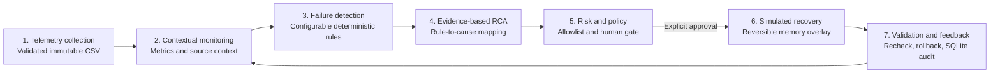

# Autonomous Recovery in MLOps

**Intelligent Detection, Root Cause Analysis, and Safe Self-Healing for ML Pipelines**

A local college-project prototype of the seven-layer governed recovery control loop in the supplied `Final Research paper.pdf`. The application is a demonstration, not production infrastructure: **all operational measurements, incident labels, diagnoses, approval states, injected faults, and recovery results are simulated**. It makes no cloud, Kubernetes, shell, model-deployment, or external-service calls.

For step-by-step application instructions, see the [User Guide](USER_GUIDE.md).

## Data integrity and scope

The input `mlops_crime_telemetry_synthetic.csv` is treated as an immutable telemetry/scenario dataset. It is **not raw model-training data**, and this app does not train a crime-prediction model. Operational values and scenario labels are synthetic. The crime-domain context and aggregate batch counts are source-derived context only. The application does not infer individual facts, personal crime risk, or community crime risk.

The supplied CSV was inspected before implementation: it has 1,200 rows and 24 expected columns; 747 rows are `SIMULATED_NORMAL_RUN` and 453 are `SIMULATED_FAULT`. Scenario labels are 747 normal, 137 data drift, 92 high latency, 86 missing data, 74 schema errors, and 64 training failures. `incident_id` is blank for most rows; other required values are populated. The four domain contexts and four model versions each have 300 records. The API validates the full expected column set, types, timestamp values, and unique run IDs on load. Unknown/missing columns are rejected with a helpful error.

The detector is a separate, deterministic rule set. Its default thresholds are drift score `> 0.35`, missing-data rate `> 0.10`, and latency `> 2000 ms`; invalid schema and failed training are boolean rules. Defaults are visible and adjustable in the Recovery Lab. They are prototype choices, not statistically calibrated operating limits. The CSV's scenario labels are retained separately for an honest prototype evaluation; overlapping signal values mean false positives and false negatives are expected.

## What is implemented

- **Overview:** filtered summary metrics, five telemetry timelines, fault-category chart, and synthetic-data disclosure.
- **Runs:** searchable/sortable telemetry explorer with all 24 source fields, detector output, evidence-based deterministic diagnosis, recommendation, and scenario truth in a detail drawer.
- **Add run:** enter a synthetic telemetry scenario from the Runs page. New entries are validated and persisted in a separate SQLite table; the supplied CSV remains unchanged. They appear in filters, dashboards, run detail, evaluation, and exports. Their approval state starts false and recovery validation starts unknown; creating a scenario does not approve or execute an action.
- **Recovery Lab:** adjustable deterministic thresholds, no-fault view, in-memory fault injection, allowlisted actions, explicit approval prompts, and confirmed reset.
- **Policy and simulation:** recommend-only default; every action requires explicit human approval. Schema-invalid and training-failure cases are high risk. Actions modify only a reversible in-memory overlay, never the CSV or a real model/service. The API checks that the submitted action matches the current recommendation. Post-action rule validation either marks the simulation validated or restores the previous overlay and escalates.
- **Evaluation:** confusion matrix, precision, recall, F1, false-positive rate, and false-negative rate against the synthetic scenario labels. Reports are named **prototype evaluation against simulated scenario labels**. Detection/recovery time is shown as not derivable because the available records do not contain event-arrival or action-duration timestamps.
- **Audit Log:** local SQLite records for user-entered runs and for run inspection/detection, diagnosis, recommendation, rule changes, fault injection, approval, execution, validation, rollback, reset, and action history. Audit and filtered run exports are available as JSON and CSV.
- **Architecture & Limitations:** the seven paper layers, app mapping, demo walkthrough, and research limitations.

Root-cause analysis maps detector rules to causes and cites the supporting telemetry field/value. Its confidence is a rule-based category, not a calibrated probability; it does not claim causal ground truth. There is no LLM.

## Research paper summary

The supplied paper, *Autonomous Recovery in MLOps: An Intelligent Framework for Failure Detection, Root Cause Analysis, and Self-Healing Machine Learning Pipelines*, proposes seven loosely coupled layers: data collection and telemetry; contextual monitoring; failure detection; root-cause analysis; a risk-governed decision engine; self-healing execution; and validation/feedback. Its workflow gathers and contextualizes signals, detects candidates, diagnoses from evidence, ranks actions under policy, escalates actions above an automation risk threshold, executes with rollback hooks, validates stability, and updates the audit/knowledge loop.

The paper describes a conceptual architecture and future empirical work, not a demonstrated production recovery system. It calls for future testbeds with public streaming data and injected Kubernetes faults, and lists limitations including telemetry integration cost, scarce RCA ground truth, cascading-remediation risk, and LLM latency/hallucination. This project follows the seven-layer organization but deliberately replaces live infrastructure execution with human-approved, reversible local simulation. Its limitations are presented in the app rather than treated as research results.

## Architecture



```text
backend/app/
  config.py       environment configuration
  data.py         CSV schema/type validation and immutable loading
  detection.py    deterministic thresholds and rule evaluation
  rca.py          evidence-grounded diagnosis mapping
  policy.py       allowlisted recommendation catalog and approval policy
  simulation.py   in-memory overlays, validation, rollback
  evaluation.py   prototype classification metrics
  database.py     parameterized SQLite audit/action persistence
  api.py          FastAPI routes, filtering, exports, injection
frontend/src/
  App.tsx         React application and API-backed views
  styles.css      responsive local UI
```

## Requirements

- Windows 10/11, PowerShell, Python 3.11 or later, Node.js 20 or later, and npm.
- The input CSV stays in the workspace root by default. Configure another location with `ML_TELEMETRY_CSV`.
- All services bind to loopback by default. SQLite is created locally at `backend/mlops_audit.sqlite3` and is ignored by Git. User-entered demo runs persist across API restarts; temporary fault/recovery overlays do not.

## Run locally (PowerShell)

From the workspace root (`D:\Research Paper\MLoPs`):

```powershell
py -3 -m venv .venv
.\.venv\Scripts\Activate.ps1
python -m pip install --upgrade pip
python -m pip install -r requirements.txt
Copy-Item .env.example .env
```

If PowerShell blocks virtual-environment activation, run `Set-ExecutionPolicy -Scope Process -ExecutionPolicy Bypass` in that terminal and activate again. Alternatively, invoke `.\.venv\Scripts\python.exe` directly instead of activating.

Start the backend in PowerShell window 1 from the workspace root:

```powershell
python -m uvicorn backend.app.main:app --reload --host 127.0.0.1 --port 8000
```

Start the frontend in PowerShell window 2:

```powershell
Set-Location frontend
npm install
npm run dev
```

Open <http://127.0.0.1:5173>. API health is at <http://127.0.0.1:8000/api/health>; interactive API docs are at <http://127.0.0.1:8000/docs>. Vite proxies `/api` to the local backend. The UI's fonts use local system fallbacks; no remote font or telemetry services are needed.

To point at another CSV, edit `.env` (or set a process environment variable before starting the backend):

```powershell
$env:ML_TELEMETRY_CSV = 'D:\data\mlops_crime_telemetry_synthetic.csv'
```

The API never writes to the configured CSV. Test and build commands, from the workspace root:

```powershell
python -m pytest backend/tests -q
Push-Location frontend
npm run build
Pop-Location
```

## Example API calls

PowerShell examples use `Invoke-RestMethod`:

```powershell
Invoke-RestMethod http://127.0.0.1:8000/api/health
Invoke-RestMethod 'http://127.0.0.1:8000/api/dashboard?incident_type=data_drift'
Invoke-RestMethod 'http://127.0.0.1:8000/api/runs/run_00003'
Invoke-RestMethod http://127.0.0.1:8000/api/evaluation
```

Add a user-entered synthetic run. The API validates values, generates a local ID/label, and persists it in SQLite without writing to the CSV:

```powershell
$newRun = @{
  incident_type = 'missing_data'
  crime_domain_context = 'Demo aggregate context'
  crime_records_in_daily_domain_batch = 12
  data_quality_missing_rate = 0.42
  feature_drift_score = 0.15
  validation_f1 = 0.61
  pipeline_latency_ms = 450
  schema_valid = $true
  training_success = $true
} | ConvertTo-Json
Invoke-RestMethod -Method Post -Uri http://127.0.0.1:8000/api/runs -ContentType 'application/json' -Body $newRun
```

The created run has `SIMULATED_USER_ADDED` status, `action_approved=false`, and `recovery_validation_passed=null`. Adding telemetry never approves or executes a recovery action.

Configure thresholds (values are prototype settings):

```powershell
$body = @{ drift_score = 0.35; missing_rate = 0.10; latency_ms = 2000 } | ConvertTo-Json
Invoke-RestMethod -Method Put -Uri http://127.0.0.1:8000/api/rules -ContentType 'application/json' -Body $body
```

Inject a scenario into a reversible in-memory overlay; this does not change the source record:

```powershell
$inject = @{ scenario = 'data_drift' } | ConvertTo-Json
Invoke-RestMethod -Method Post -Uri http://127.0.0.1:8000/api/runs/run_00003/inject -ContentType 'application/json' -Body $inject
```

An approved simulation must use the current allowlisted recommendation returned by the run detail endpoint. The UI prompts for approval and sends it explicitly:

```powershell
$approval = @{ action_id = 'compare_baseline'; human_approved = $true } | ConvertTo-Json
Invoke-RestMethod -Method Post -Uri http://127.0.0.1:8000/api/runs/run_00001/simulate -ContentType 'application/json' -Body $approval
```

Export endpoints are `GET /api/export/runs.csv` and `GET /api/export/audit.json`. Roll back a specific local action using `POST /api/actions/{action_row_id}/rollback`. Reset requires `POST /api/simulation/reset` with `{"confirmed":true}` and is also confirmed by a browser dialog.

## Presentation walkthrough

1. Start both services and introduce the project as a **local research prototype**, not production MLOps or autonomous infrastructure.
2. On Overview, point out the 1,200 scenario rows and name all operational values as simulated. Use the filters and explain the scenario-label/detector distinction.
3. In Runs, inspect `run_00003` (normal scenario), then search one each of `data_drift`, `missing_data`, `schema_error`, `high_latency`, and `training_failure`. Read the exact evidence field and rule threshold in the detail drawer.
4. In Recovery Lab, demonstrate a threshold change and a fault injection. Explain that injection changes an in-memory copy only. Inspect a high-risk schema or training recommendation and the human approval gate.
5. Approve a missing-data batch quarantine simulation. Show pre/post alerts, validation, and the resulting audit events. Use undo or the confirmed reset to restore demonstration state.
6. In Evaluation, discuss the confusion matrix and false positives, and state that these are prototype metrics against synthetic scenario labels, not production performance. MTTD/MTTR are unavailable from the supplied records.
7. Finish with Architecture & Limitations and export the filtered results/audit log if needed for the presentation.

## Troubleshooting

- **Dataset unavailable:** confirm the CSV is in the workspace root or set `ML_TELEMETRY_CSV`. `/api/health` returns a degraded status and a useful path error if it cannot load.
- **CSV rejected:** check for the exact 24 expected headers, valid boolean/numeric fields, parseable timestamps, and unique `run_id` values. Unexpected columns are rejected intentionally.
- **Port is occupied:** use another backend port and update `frontend/vite.config.ts` proxy, or use another Vite port with `npm run dev -- --port 5174`.
- **Browser shows API unavailable:** start the backend first and verify `http://127.0.0.1:8000/api/health`.
- **PowerShell activation denied:** use the process-scoped execution-policy command above or invoke the virtual-environment Python executable directly.
- **Reset database:** stop the backend, remove `backend/mlops_audit.sqlite3` only if you intend to permanently clear local audit history, then restart. The source CSV is separate and is never modified.

## Limitations and ethical scope

Synthetic operational telemetry; synthetic scenario labels; no real production monitoring; no actual infrastructure or model recovery; small local prototype; no independent causal ground truth beyond scenario generation; thresholds can overfit synthetic scenarios; no derivable MTTD/MTTR; no guarantees of production effectiveness. Crime data is used only as aggregate/source-derived context and is not used to predict or target individuals or communities.